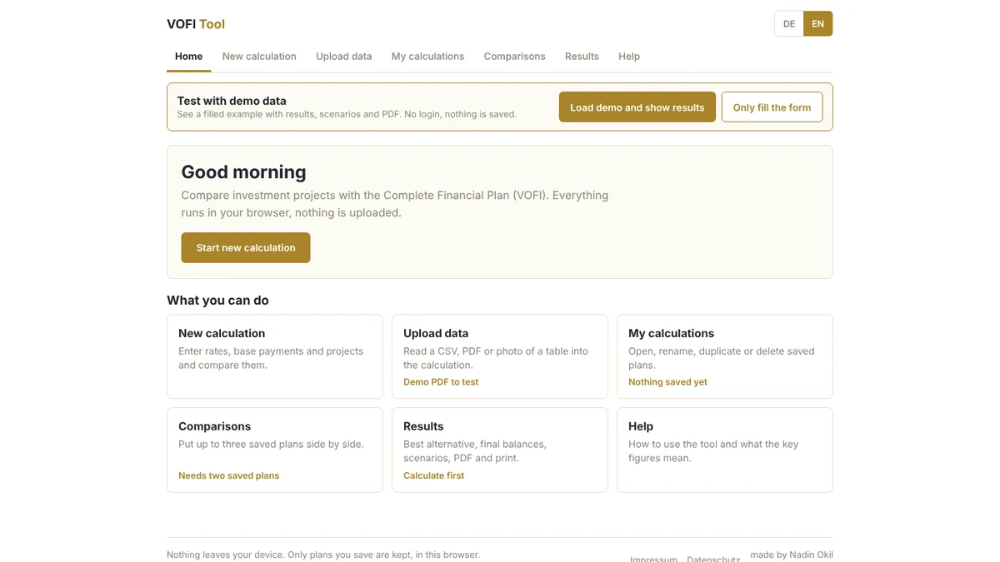

# VOFI Tool (Complete Financial Plan)

**Live:** https://vofi-tool.nadin.dev



A small interactive tool for comparing investment projects under a deposit rate and a borrowing rate, following the VOFI method (vollständiger Finanzplan) used in German investment analysis courses.

## What it does

For each project, and for a "do nothing" alternative, it builds the account balance period by period, applying the deposit rate when the balance is positive and the borrowing rate when it is negative. Withdrawals follow a starting value and a ratio across periods. If a project's balance would fall below a set credit limit, it is marked as not feasible. Projects are ranked by final balance.

## Why VOFI instead of NPV

Standard NPV or IRR calculations assume a single discount rate. VOFI is more realistic once deposit and borrowing rates diverge, which is common in practice and central to how this topic is taught in German finance courses (see Grob, Kruschwitz).

## Importing real data

Besides pasting text, the tool reads a PDF with a text layer, a scanned PDF, a photo of a table (PNG, JPG), CSV or TXT. Scans are read with text recognition (tesseract.js, German and English). Everything happens in the browser tab, the file is never uploaded. The recognised text appears in the box so every number can be checked before it is applied. Results can be copied, downloaded as CSV (semicolon separated, opens in Excel) or printed and saved as PDF.

The recognition files (worker, wasm, language data, PDF worker) live in `public/ocr` and are served from the same origin, so the Content-Security-Policy needs no third party host.

## Extended version

Start page, navigation (Startseite, Neue Berechnung, Meine Berechnungen, Vergleiche, Ergebnisse, Hilfe), saved calculations (save, edit, duplicate, rename, delete, backup file), results overview, scenario analysis (optimistic, realistic, pessimistic), A4 PDF export (jsPDF, vector text, tables and chart), printing and a help area. Saved plans live in the browser's localStorage only (`vofi.v1.plans`) and are never uploaded.

The VOFI formula is unchanged: `computeAccountBalance` moved verbatim to `core.js`. Scenarios change positive project cash flows by a percentage and both interest rates by percentage points, nothing else.

Checks: `npm test` (formula against an independent version, scenarios, storage) and `node tests/e2e.mjs` against `vite preview` (Playwright, mobile and desktop).

## Run it

```
npm install
npm run dev
```

## Structure

```
core.js       VOFI formula (computeAccountBalance), scenarios
store.js      saved plans in localStorage
fileImport.js PDF, scan, photo, CSV and TXT import
report.js     result tables and A4 PDF content
pdf.js        jsPDF export
views.jsx     screens (start, calculation, comparison, results, help)
i18n.js       German, English, Arabic texts
tests/        formula and storage tests, e2e.mjs
```

## Tech

React 18 and Vite, inline styles, no UI or chart library. jsPDF is loaded only when the PDF button is pressed.
